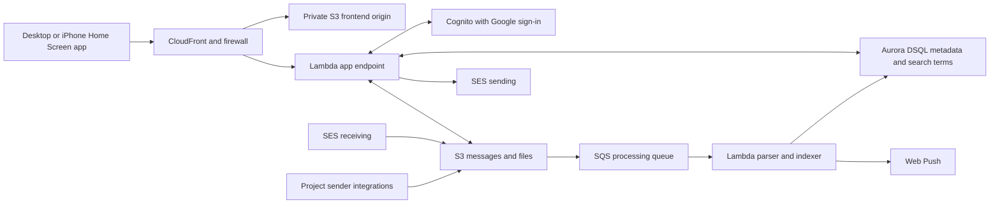

# Low-cost inbox architecture proposal

October 26, 2026 · For review before implementation. This document proposes the design; it does not authorize deployment or changes to other projects.

## Recommendation and budget

Use a dedicated private Example subdomain, a static installable interface, short-lived Lambda execution, one independent Aurora DSQL database, and S3 mail storage. Capture ordinary automated project email through a shared sender integration into app-owned storage. The database and functions have usage charges rather than an hourly compute baseline. Persistent storage remains billable as the mailbox grows.

Recommend an initial **US$5/month working budget**, with cost alerts proposed at US$5 and US$10. The illustrative personal workload below models US$1.96/month, or US$2.96 including a US$1 contingency. These are estimates, not a spending cap or measured application costs. Validate search consumption and hosting compatibility before provisioning the production design.

The owner confirmed a 30-day private backup recovery window after permanent deletion. Mail disappears from normal app access immediately; restore must respect the deletion record. Verification-code and password-reset emails are excluded from automated Sent capture. Ordinary app-generated notifications, invitations, reminders, and contact-form deliveries remain included, from both staging and production.

## Components and boundaries

- **Hosting:** a new CloudFront distribution on its ongoing Free pricing plan, subject to account eligibility and a configuration spike. Its documented allowance is 1 million requests and 100 GB/month, with five cache behaviors and included firewall/rate-limiting capabilities. Existing public website distributions remain independently managed. An ACM certificate and a record in the existing Example zone serve the new subdomain. Do not create another hosted zone solely for this app. [CloudFront pricing](https://aws.amazon.com/cloudfront/pricing/)
- **API:** an AWS_IAM Lambda function URL behind CloudFront origin access control. Restrict invocation to this distribution; configure both required Lambda invocation permissions. This avoids a separate API Gateway layer for the single-owner app. CloudFront signs origin requests; the application still independently authenticates the owner. [Lambda origin access](https://docs.aws.amazon.com/AmazonCloudFront/latest/DeveloperGuide/private-content-restricting-access-to-lambda.html)
- **Database:** a separate single-region Aurora DSQL database in the production account, for domains, aliases, mailbox entries, draft metadata, sessions, devices, send attempts, work state, and indexed search terms. Use IAM authentication and scoped database roles. Keep it separate from ExampleOrg's application database. The verified N. Virginia rates are US$8/million DPUs and US$0.33/GB-month; idle compute has no hourly charge. [DSQL pricing](https://aws.amazon.com/rds/aurora/dsql/pricing/)
- **Mail and files:** new private S3 Standard storage for original MIME, normalized bodies, inline images, attachments, and recovery objects. Use encryption at rest, TLS, public-access blocks, and scoped IAM/bucket policies. Serve downloads through short-lived CloudFront signed URLs to the private file origin, with caching disabled, so download traffic stays inside the modeled CDN path.
- **Ingestion:** S3 events into a standard SQS queue and a Lambda worker, with idempotent processing, bounded retry, and a dead-letter queue. Durable S3 input and processing state permit replay if queue delivery or parsing fails. Use normal on-demand processing and measure empty polling requests as well as successful work.
- **Login:** a dedicated Cognito Lite pool with Google federation, allowing initial enrollment only for verified owner@example.net. Enforce the enrolled stable owner identity thereafter. Use Google/Cognito only for authentication, with no Gmail access. Public sign-up is disabled.
- **Sessions:** exchange the authorization code on the backend, validate the identity, and issue an opaque session cookie using Secure, HttpOnly, SameSite, and host-only scope. Store only a hash of the session identifier in the database. Proposed session maximum is seven days, with explicit revocation on logout; do not persist OAuth refresh tokens in browser storage. Use state/nonce/PKCE and same-origin/CSRF checks for mutations.
- **Push:** VAPID Web Push from a Lambda worker using authenticated device subscriptions. Display sender and subject, without body text. Clicking opens the correct domain/message and requires sign-in if the session expired. Device push enrollment can outlive the UI session; explicit device logout/revocation removes its subscription. Test the iPhone Home Screen installation flow on the actual device.
- **Secrets and operations:** budget two Secrets Manager secrets for OAuth and application signing/push material, cached in warm workers. Use service-managed encryption where suitable; the chosen scope does not require a custom Cognito email-sender KMS key. Keep compact logs with a short retention window and a small fixed set of operational alarms. Avoid email bodies, OAuth codes, session tokens, and signed URLs in logs.

The CloudFront spike must prove managed caching-disabled/origin-request policies, cookies, query strings, S3 access, response headers, and function URL OAC work within the Free plan. Set page security headers through the supported response mechanism; a CloudFront Function is available if a custom response-header policy is unavailable in this plan. JSON requests through Lambda OAC require a SHA-256 payload header, which the app's request helper must generate. Never accept cached private API or download responses to preserve a lower price tier. [Plan feature boundaries](https://docs.aws.amazon.com/AmazonCloudFront/latest/DeveloperGuide/flat-rate-pricing-plan.html)

## Mailbox identity

Each alias has separate Inbox, Sent, Drafts, Archive, Trash, Spam, unread state, search results, and thread history. Group addresses under the domain workspace, with address tabs above the message list. Example uses green accents and ExampleOrg blue, retaining dark-grey text. Compose/reply/forward fixes the sender to the selected enabled address.

Key mailbox entries by domain, address, and message ID. Route incoming mail from actual SES envelope recipients; one delivery to two aliases creates two independently managed entries referencing shared immutable content. Sent capture belongs to the actual sender address. Captured-only no-reply senders get a read-only mailbox and are not automatically enabled for manual sending/receiving. Drafts, search joins, direct lookups, and notification routes must enforce the selected address scope. Deletion tombstones include mailbox identity; one address’s permanent deletion must not remove another retained copy or permit replay to recreate the deleted entry. The prototype derives these entries from existing local fixtures without resetting saved mail/drafts.

## Search without a dedicated search service

Aurora DSQL is the recommended primary database, but this proposal does **not** assume PostgreSQL's native tsvector/GIN full-text search is available. Use an application-maintained word index in ordinary relational tables, indexed by domain, normalized term, and message ID. Store positions/field information for phrase matching. Search joins matching term rows to current mailbox metadata, enforcing the selected address and applying folder, environment, and date filters before final pagination. Original body/HTML remains in S3.

Version one supports ordinary word/phrase searches over sender, recipients, subject, and message text, with clear field filters. This is lexical search; fuzzy typo matching, semantic search, and attachment-content OCR are outside the currently requested feature set. Avoid fetching every message body or scanning an entire growing mailbox on each search. Tokenization, normalization, phrase semantics, and index-generation visibility need focused validation.

The approved isolated staging experiment now validates the candidate schema and query primitives on DSQL, with short synthetic retained-mail datasets and an edge-case message. See [storage design](BACKEND_STORAGE.md) and [measured benchmark](planning/STORAGE_BENCHMARK.md). It exposed repeated address-token lookups; the probe now compares grouped matching and bounded posting hints as well as the original queries. Production still needs representative mail, full ingestion/draft/session operations, cleanup/restore, and storage metrics before committing to an operating budget. The cost model's DPU amounts remain budget inputs rather than a proven conversion from messages to complete app work. [Supported DSQL SQL](https://docs.aws.amazon.com/aurora-dsql/latest/userguide/working-with-postgresql-compatibility-supported-sql-features.html)

**Credible alternative:** Aurora PostgreSQL serverless provides native indexed full-text search and could reduce custom search code. Its compute cost depends on active capacity and how often ingestion or sessions keep it awake; auto-pause introduces resume behavior. Reconsider it if the DSQL word index is more complex or costly in practice than this small app justifies. Compare measured workloads before a service switch rather than adding both databases. [Aurora pricing](https://aws.amazon.com/rds/aurora/pricing/)

## Automated Sent and permanent deletion

Prefer **app-controlled capture in the send path** over a permanent Mail Manager compliance archive. This permits a single user-facing retention/deletion policy and avoids a separate archive/import mechanism. SES events remain useful for delivery status, not message-body capture.

For ordinary application mail, a shared helper persists a complete message representation and its send-attempt ID before calling SES. It can store canonical MIME or a complete versioned representation that preserves text, HTML, inline images, and attachments; choose one format consistently in the implementation review. Preserve existing recipients, Reply-To, subject/body, configuration sets, tags, and outcome handling. Persist the returned SES ID or an explicit failed/uncertain outcome. The mailbox worker imports the durable capture asynchronously, normally within a few minutes, labelling source and environment.

The producer writes only to its assigned account/environment prefix; consumers derive trusted source labels from IAM/prefix configuration. Cross-account staging producers receive write-only access to their capture prefix and cannot read production mail. Capture work is event-driven rather than repeatedly searching an archive. Treat ambiguous SES responses conservatively; capture deduplication does not make the SES send operation exactly-once.

Capture-storage failures must be explicit: do not silently claim complete Sent coverage if a source sent mail without a durable capture. Indexing downtime can be retried independently after the durable capture exists. Decide source-level fail/queue behavior in the concrete integration review, especially for urgent invitations. Roll out producer by producer with a recovery/rollback path.

Expected source integration points, to review before edits:

- ExampleOrg: library/server/invitation-mail.mjs and learning-mail.mjs, their existing configuration-set feedback flow, and narrowly scoped infrastructure permissions.
- Website: functions/contact/handler.ts and contact-stack.ts, preserving private routing and form safeguards.
- Platform-generated verification/reset emails: excluded by owner decision. Do not replace Cognito's verification/password-reset delivery flow merely for mailbox capture. Review any platform-generated ordinary invitation separately so it is not silently omitted.
- Future projects: integrate the shared helper with the project's existing authenticated AWS role; do not create a public ingestion endpoint that accepts arbitrary mail or sender labels.

Native SES archiving remains a fallback only if the desired capture coverage cannot be implemented cleanly. Its documented deletion operates at archive scope, and the shortest listed archive retention is three months. That does not directly fit the agreed per-message deletion/30-day recovery policy. [Archive retention](https://docs.aws.amazon.com/sesmailmanager/latest/APIReference/API_ArchiveRetention.html), [archive deletion](https://docs.aws.amazon.com/sesmailmanager/latest/APIReference/API_DeleteArchive.html)

## Retention, recovery, and aliases

- Keep active mail indefinitely in every folder, including Spam and Trash. Size is a cost input, not an automatic expiry trigger.
- Moving to Trash changes folder state only. Explicit permanent deletion immediately removes normal application access, live search results, downloads, and visible content.
- Keep private recovery copies for up to the agreed 30-day window. Retained live messages are never expired by backup cleanup. Specify and monitor cleanup for S3 versions and logical database snapshots; lifecycle expiry alone is asynchronous.
- Retain minimal non-content deletion records so replay/import and restore cannot resurrect deleted mail. A restore must apply these records before making the mailbox accessible. Preserve content referenced by another retained address entry.
- Use versioning for immutable mail content and a daily logical export of mailbox/configuration metadata for the recovery window; include retained versions and export activity in storage/usage measurements. Validate a restore locally and in the controlled environment before launch. Final deletion/recovery timing must be described accurately in the UI and runbook.
- Enable the four launch aliases in the application and exact-recipient SES rules. Aliases do not require separate inbox infrastructure or paid per-mailbox licenses. Sender display names/default aliases can be selected during interface review.
- The production account has one active receiving rule set. Extend or migrate it with a coordinated change to the existing support rule, preserving support receiving throughout cutover. The application-managed alias rule must have one owner and must not be overwritten by unrelated CloudFormation deployments.
- Copy or otherwise protect support mail before a reviewed cutover to new durable storage. The current 14-day policy remains unchanged until the transition is explicitly implemented.

## Monthly cost model

N. Virginia, USD, verified October 26, 2026. These are illustrative incremental workloads, not growth forecasts. The active project audit found much lower volume. Counts include staging and production capture together. The figures below charge published usage rates without deducting shared Lambda/DSQL/SQS/SNS/S3/Cognito free allowances or signup credits. CloudFront's chosen ongoing $0 plan is modeled at $0; its eligibility, limits, and secure configuration are a launch gate.

| Monthly input or result | Personal | Active | Growing |
| --- | ---: | ---: | ---: |
| Incoming messages | 200 | 2,000 | 10,000 |
| Outgoing recipients | 200 | 2,000 | 10,000 |
| Total physical S3 storage, including recovery copies | 2 GB | 10 GB | 100 GB |
| Metadata/search storage | 0.25 GB | 1 GB | 5 GB |
| Budgeted DSQL work, to benchmark | 50,000 DPUs | 250,000 DPUs | 2,000,000 DPUs |
| Modeled monthly total | **$1.96** | **$5.23** | **$29.08** |
| With $1 contingency | **$2.96** | **$6.23** | **$30.08** |

The Personal subtotal comprises database work/storage $0.48, S3 storage/requests $0.08, Lambda $0.06, email $0.08, queues/publishing $0.10, secrets $0.81, logs/alarms $0.35, social login $0.01, and the $0 CDN plan. Rounded components may not sum to the rounded total. Database query/index work is the largest uncertainty and dominates the Growing scenario; it must be measured before extrapolating.

For long-term retention, S3 Standard storage alone is $0.23/month at 10 GB, $2.30 at 100 GB, and $23.00 at 1,000 GB under the verified first-tier rate. This is physical storage across originals, attachments, and recovery copies—not a promise that one gigabyte of incoming mail occupies exactly one gigabyte in the final app. Database/index and request costs are additional. [S3 pricing](https://aws.amazon.com/s3/pricing/)

The estimates exclude existing domain registration/hosted-zone fees, unrelated project bills, taxes, and development labour. They assume files are served through the modeled CDN within its usage allowance; direct S3 internet downloads, extra transfer paths, or a required CDN plan change need another line in the model. Email assumptions use one inbound size chunk/message and specified outbound attachment volumes. Heavy attachments, polling, retries, bigger text indexes, and larger retained storage can change the result. Existing project sending should not be counted twice when describing the incremental inbox cost; this model intentionally includes its total scoped mail traffic as a conservative operating example.

Reproduce and modify the model with `python3 planning/estimate_costs.py`. Inputs, all rates/source links, and detailed workload assumptions are in planning/cost_inputs.json; output is planning/cost_estimate.json. Price List API evidence is retained locally in .audit/proposal-pricing.json. [Lambda](https://aws.amazon.com/lambda/pricing/), [SES](https://aws.amazon.com/ses/pricing/), [SQS](https://aws.amazon.com/sqs/pricing/), [SNS](https://aws.amazon.com/sns/pricing/), [Secrets Manager](https://aws.amazon.com/secrets-manager/pricing/), [CloudWatch](https://aws.amazon.com/cloudwatch/pricing/), [Cognito](https://aws.amazon.com/cognito/pricing/).

## Implementation sequence and review points

1. **Local feasibility work:** prototype domain navigation, rich compose, safe reading, drafts, and the word-index query behavior using fixtures. Test the S3/Lambda OAC configuration and DSQL compatibility through reviewed definitions and focused checks; any live resource creation is a separate reviewed step. Measure search/index DPU use on representative mail before committing to the production budget.
2. **Foundation proposal:** define the new app's infrastructure, domain/account ownership, schema, session rules, storage/backup cleanup, source permissions, and the final private URL. Review the diff and actual projected resource charges before provisioning. Keep existing public-site resources separately owned.
3. **Mail and alias integration:** connect exact-recipient receiving, manual send/reply/forward, inline images/files, durable ingestion, search, and delivery status. Review the coordinated support-mail cutover and SES production-access request. Both domains are verified, but production access is still a launch blocker.
4. **Ordinary automated Sent:** review source-specific file changes and failure behavior; integrate staging/production producers one at a time, excluding verification/reset delivery. Existing ExampleOrg instructions require review of implementation details before its source/infrastructure edits; the website and ExampleOrg deployments remain separate release actions.
5. **Device and recovery verification:** test Google owner rejection, direct-origin denial, cross-domain access, app-closed iPhone push, deletion/replay, and recovery without resurrecting deleted mail. Recalculate the estimate with measured usage and publish only the reviewed release.

All confirmed version-one features remain in scope. If a feasibility test fails, bring back the concrete alternative and cost effect before expanding the infrastructure.
