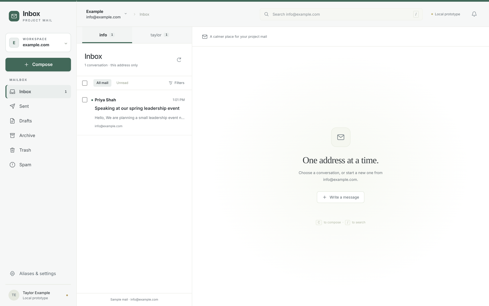
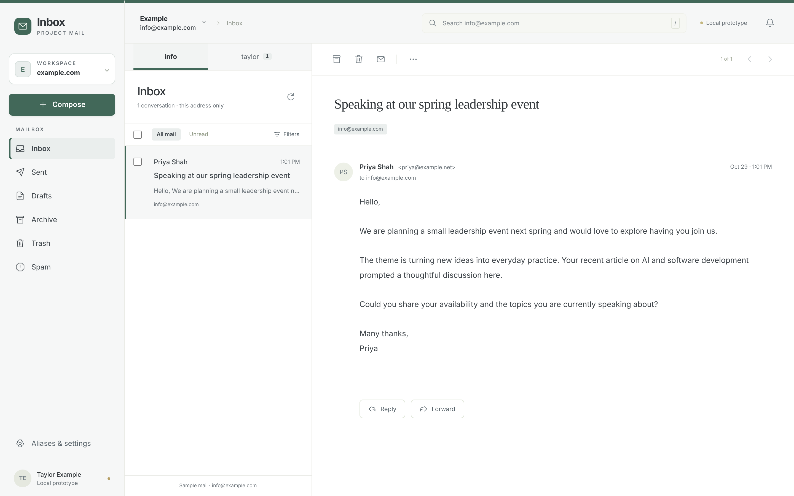
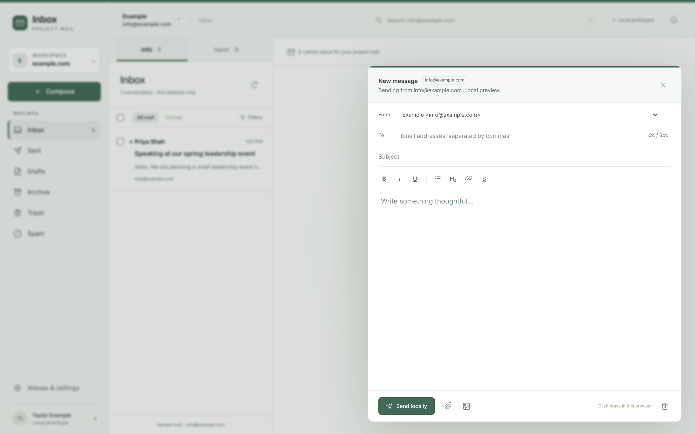
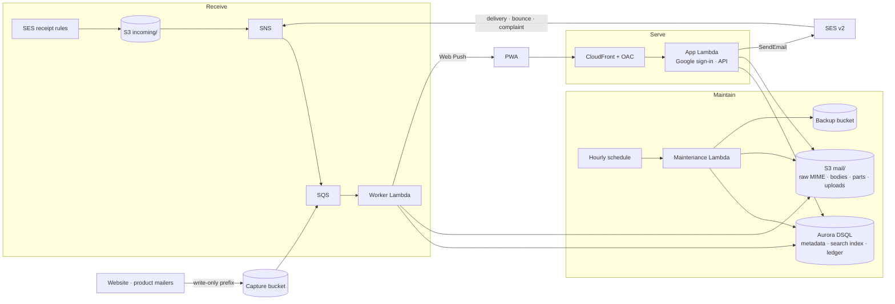

# SES Inbox

A private, multi-domain web mailbox built directly on Amazon SES, Aurora DSQL and S3 — with server-side search, a deletion ledger, verified backups and automated capture of mail that other systems send.

I built it to replace a hosted mailbox for two small domains of my own (a personal site and a product). It has been running my real mail in production since October 2026. This repository is published as a **reference implementation**: the code, infrastructure templates, tests and runbooks are all here so you can read how it is built. It is not packaged as a turnkey product, and the hosted deployment itself stays private.

Every domain, address, account ID and resource name in this repository is a placeholder (`example.com`, `example.org`, `111111111111`, …). The sample messages are fictional.



## Try it in one command

The local preview needs only Node.js 22. No dependency installation, AWS credentials or cloud resources — it uses fictional sample messages and browser-local storage, and **"Send locally" never sends an email**.

```sh
npm run dev
```

Open <http://127.0.0.1:4317>. Narrow the window to see the phone layout. `C` composes, `/` searches, `⌘/Ctrl+Enter` sends locally.

Things to try: switch between the two workspaces and their addresses; reply, forward and compose with formatting, inline images and attachments; close a draft, reload, and reopen it from Drafts; search with words or quoted phrases; archive, trash, undo and permanently delete; add or disable an address in *Aliases & settings*.

<p>
  
  
</p>

## What it does

- **Several domains, several addresses, one owner.** Each address has its own folders, unread state, drafts, search and thread history. A message delivered to two addresses is two independent copies.
- **Receiving** through SES receipt rules into S3, then SNS → SQS → a worker Lambda that parses MIME, files the raw original and every part, indexes search positions and threads by `Message-ID`/`References`.
- **Sending** through SES v2 with the sent copy stored and indexed *before* the API call. Each attempt is recorded once; definite SES errors mark it failed, anything ambiguous is left `uncertain` and never retried blindly. Delivery, bounce and complaint events flow back through the same queue onto the message.
- **Search without a search service.** Positional term indexes in DSQL support word and quoted-phrase search per address, with a benchmark that chose the query strategy per case ([planning/STORAGE_BENCHMARK.md](planning/STORAGE_BENCHMARK.md)).
- **Delete forever means forever.** Permanent deletion writes an independent S3 deletion intent and a SQL tombstone first; a non-content ledger persists so replay and restore cannot resurrect a deleted message. Retired content is swept at 29 days; retained mail never expires by age.
- **Backups you can restore.** An hourly maintenance Lambda produces checksummed, manifest-committed backups into a separate encrypted bucket. Restore only ever targets an empty isolated destination and applies the latest deletion ledger; overwriting live data is refused. Restore and deletion drills were run against the cloud, not just locally.
- **Automated Sent capture.** Mail that other systems send on the domains' behalf (a website contact form, a product's invitation emails) is captured into the owner's Sent folder through a source-scoped, write-only intake — producers get an exact S3 prefix and nothing else.
- **Owner-only access.** CloudFront (OAC, SigV4) → Lambda function URL (IAM auth) → a Google sign-in gateway restricted to one account. The direct function URL returns 403.
- **A PWA with Web Push.** New Inbox mail sends a sender/subject notification to every enrolled device and can forward a copy to outside addresses, at most once per target.
- **Email HTML is treated as hostile.** Active content is stripped and rich messages render inside sandboxed frames.

## Architecture



The web client is plain ES modules with no framework; the same `web/` code runs against browser-local IndexedDB in the preview and against the API in production. Infrastructure is plain CloudFormation generated from JavaScript (`infra/`), deployed by change sets that a person reviews.

| Directory | What is there |
| --- | --- |
| `web/` | The client: model, rendering, local storage, HTML safety, service worker |
| `mail/` | Production mail: schema, repository, ingest, send, drafts, search text, retention, backup, push |
| `capture/` | Automated Sent intake worker and producer protocol |
| `infra/` | CloudFormation templates for production, staging and capture |
| `stage/` | The sample-data staging deployment and its Google sign-in gateway |
| `scripts/` | Packaging, initialization, release checks, recovery and drill tooling |
| `tests/` | Node test suite plus Playwright browser journeys |
| `planning/` | Storage benchmark, DSQL diagnosis and cost model |
| `docs/` | Runbooks and the project record (see below) |

## Validation

```sh
npm test          # 103 checks: model, MIME, send/receive, retention, capture, backup/restore drill on embedded PostgreSQL (PGlite)
npm run build     # copies the frontend to dist/
npm install && npm run test:browser   # 8 Playwright journeys in isolated Chrome contexts
```

The backup/restore drill in the main suite runs against an embedded PostgreSQL. It does not reproduce DSQL-specific IAM or concurrency; those were verified in the cloud and are recorded in [docs/PRODUCTION_RECOVERY.md](docs/PRODUCTION_RECOVERY.md). The producer contract checks are skipped unless the producers' source checkouts are present beside this repository.

## Deploying your own

This is not a one-click deploy, but everything needed is here. The short version:

1. Copy `accounts.example.json` to `accounts.json` and fill in your AWS account IDs, CLI profiles and owner address. Copy `stage/config.example.json` and `production/config.example.json` likewise. All of these are gitignored.
2. Follow [docs/STAGING.md](docs/STAGING.md) for the sample-data stage (Google sign-in, DSQL, S3, CloudFront) and [docs/PRODUCTION.md](docs/PRODUCTION.md) for real mail: receipt rules, MX, sending identities, the app stack, then the recovery stack.
3. `npm run stage:check` and the `scripts/check-*.mjs` scripts report readiness without creating anything.

The runbooks were written for my deployment and then had its identifiers replaced with placeholders, so expect to adapt resource names and account layout rather than paste commands.

## Project record

The `docs/` folder is the project as it actually happened, kept because the decisions matter as much as the code:

- [ARCHITECTURE_PROPOSAL.md](docs/ARCHITECTURE_PROPOSAL.md) — the low-cost design, boundaries and monthly cost model
- [BACKEND_STORAGE.md](docs/BACKEND_STORAGE.md) and [planning/STORAGE_BENCHMARK.md](planning/STORAGE_BENCHMARK.md) — why DSQL, with measurements
- [STAGING.md](docs/STAGING.md), [PRODUCTION.md](docs/PRODUCTION.md), [PRODUCTION_RECOVERY.md](docs/PRODUCTION_RECOVERY.md) — runbooks, validation evidence and accepted risks
- [AUTOMATED_SENT.md](docs/AUTOMATED_SENT.md) — the capture design and the producer-side review
- [AWS_AUDIT.md](docs/AWS_AUDIT.md), [PROJECT_PLAN.md](docs/PROJECT_PLAN.md), [PROJECT_STATUS.md](docs/PROJECT_STATUS.md) — what existed before, the plan, and what is still open

## Author

Built by [Mass Delairi](https://delairi.com). MIT licensed — see [LICENSE](LICENSE).
